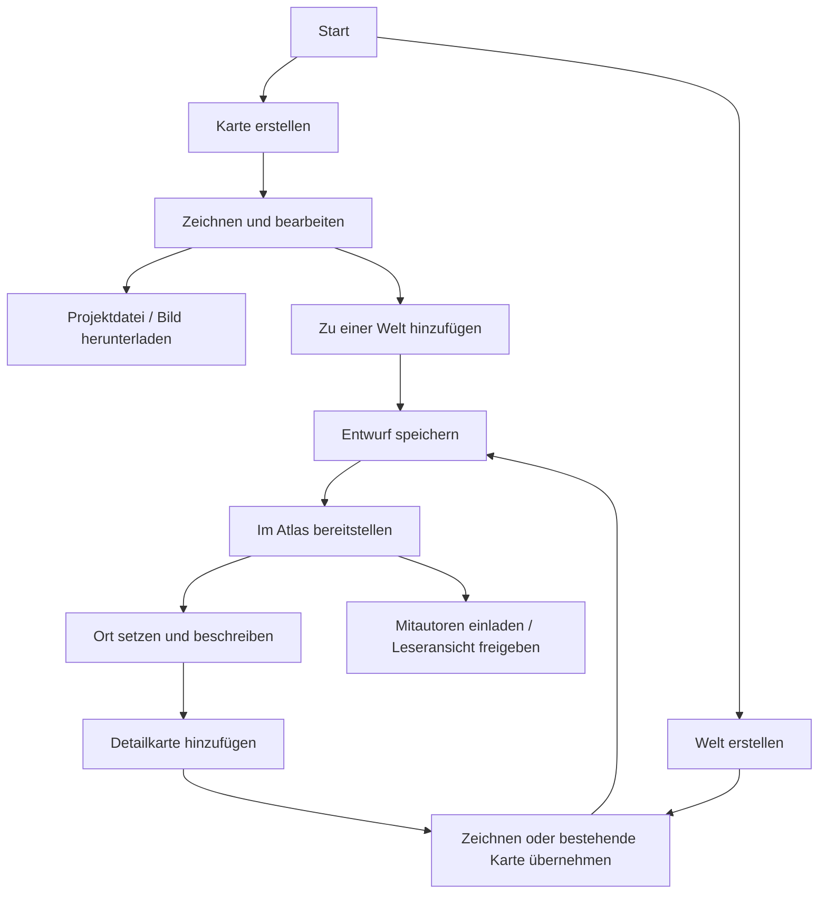
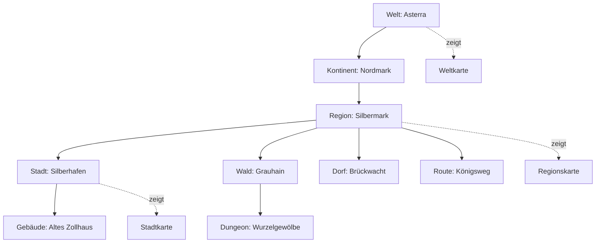

# Vom Karteneditor zum gemeinsamen Weltatlas

Stand: 25.10.2026. DAD-M Apply-Entwurf auf Grundlage der [Discover-Recherche](proofs/world-atlas-research-2026-10-25/DISCOVER.md). **Planung, keine implementierten Atlas-Funktionen und kein Deploy-Auftrag.** Der Nutzer priorisiert Desktop; Mobile/Tablet bleibt später. Produktimplementierung soll weiterhin Claude übernehmen; Codex prüft Ergebnisse und Integration.

## Ergebnis und Produktgrenze

Die [neuen Desktop-Prüfungen von Claude und Codex](proofs/world-atlas-research-2026-10-25/INTERPRETATION.md) bestätigen: Eigene Karten einschließlich Lore lassen sich erstellen, sichern, exportieren und erneut öffnen. Die strenge Abnahme bleibt wegen ungeschütztem Dateiöffnen, versehentlichem Malen beim Verschieben und unsicherem Wiederherstellungseinstieg offen. Ebenen-/Stempel-/Orts-CRUD ist weitgehend vorhanden; vollständige Projektverwaltung, eigenständige Fluss-/Wegobjekte und Welt-Hierarchie sind noch nicht implementiert.

Der Editor bleibt eigenständig nutzbar. Der nächste Produktbaustein ist ein interaktiver Atlas, der Karten, Orte, Lore und Gruppen miteinander verbindet. Eine persönliche Welt ist eine Welt mit einem Besitzer; durch Einladen weiterer DMs wird daraus eine gemeinsame Welt. Dafür ist keine Kopie des Inhalts und kein zweites Datenmodell erforderlich.

Die erste wertvolle Atlas-Version sollte einen vollständigen kleinen Arbeitsablauf liefern: zwei DMs erstellen eine Welt mit Welt-, Regions- und Stadtkarte, verknüpfen diese über Orte, pflegen Lore und eine Gruppenposition und teilen eine kontrollierte Leseransicht. Sichere gemeinsame Arbeit bedeutet zunächst auch: mehrere DMs bearbeiten verschiedene Karten; dieselbe Rasterkarte hat jeweils einen aktiven Bearbeiter. Gleichzeitiges freies Malen aller Beteiligten ist eine eigene spätere Ausbaustufe.

Das ist eine Empfehlung zur Priorität, keine bereits freigegebene Bibliotheks- oder Datenbankentscheidung. Vollautomatische Welt-/Stadtgenerierung und eine riesige unbegrenzte Zeichenfläche sind keine Voraussetzung für diesen ersten Nutzen.

## 1. Zwei Einstiege, ein anschlussfähiger Workflow

### Schnell eine Karte machen

`Karte erstellen` → leer, Vorlage oder später Bildimport → zeichnen → `Projektdatei speichern` / `Bild exportieren`.

Der lokale Einzelkartenweg bleibt ohne Weltanlage möglich. Ein verständlicher Dateidialog erklärt knapp: Projektdatei enthält bearbeitbare Ebenen/Objekte/Lore; PNG ist die dargestellte Karte als Bild. Ein zusätzlicher Anschluss `Zu einer Welt hinzufügen` macht daraus später Weltmaterial, ohne neu zu zeichnen. Bei einer noch rein lokalen Karte wird für die Serverübernahme eine Anmeldung und ausdrückliche Zielauswahl nötig.

Roll20 bleibt zunächst ein klar dokumentierter manueller Weg: Bild exportieren, in Roll20 hochladen, Karten-/Hintergrundebene wählen und bei Bedarf Raster ausrichten. Roll20 dokumentiert [Bilderuploads](https://help.roll20.net/hc/en-us/articles/360039675113-Art-Library) und einen [neuen Ausrichtungsassistenten in Beta](https://blog.roll20.net/posts/align-to-grid-new/). **Keine zugesagte API-Synchronisierung, kein automatischer Lore- oder Beleuchtungsimport.** Exportprofile mit Dateigröße, Pixelmaßen und optionaler Rasterangabe wären hilfreicher als ein irreführender „Roll20 verbunden“-Button.

### Eine Welt erschaffen

`Welt erstellen` fragt zuerst nur nach Name und privater Sichtbarkeit. Danach: `Erste Karte zeichnen` oder `Vorhandene Karte verwenden`; Einladung weiterer DMs ist optional und jederzeit später möglich. Der Benutzer darf auch mit einer Stadt anfangen und Welt-/Kontinentkarten nachtragen. Es gibt keinen Zwang, vor dem ersten Strich eine komplette Hierarchie anzulegen.

Nach dem Speichern kann der DM `Im Atlas bereitstellen`. Der Atlas öffnet die freigegebene Kartenversion, nicht einen halbfertigen lokalen Pinselzustand. Ein Ort wird per Klick gesetzt, erhält Name/Art und optional Lore. Im Ortsfenster führt `Detailkarte hinzufügen` zur nächsten Karte. Breadcrumb, Zurück-Aktion und eine kurze Hierarchieliste behalten den räumlichen Zusammenhang bei.

## 2. Flexible Hierarchie mit klarer Navigation

Empfohlen wird eine geordnete Ortshierarchie mit optionalen Karten. „Welt“, „Kontinent“, „Region/Land“, „Stadt“, „Dorf“, „Wald“, „Route“, „Gebäude“ und „Dungeon“ sind hilfreiche Vorlagen, keine erzwungene Leiter. Eine Route kann mehrere Regionen berühren; ein politisches Land und ein Wald können sich überlagern. Der primäre Elternort liefert die Navigation, zusätzliche Beziehungen bilden solche Zusammenhänge ab. Keine Mehrfacheltern im ersten Navigationsbaum und keine Zyklen.

Ein Ort ist unabhängig von seiner grafischen Darstellung: „Silberhafen“ kann als Symbol auf der Weltkarte, Punkt auf der Regionalkarte und eigene Stadtkarte erscheinen. Alle drei öffnen dieselbe Ortsbeschreibung. Ein rein dekorativer Baum oder Text bleibt dagegen ein Editorobjekt und wird nicht automatisch ein Welt-Ort.

Bei jedem Orts-/Kartenfenster: Name, kurzer Kontext, `Bearbeiten`, `Detailkarte öffnen/erstellen`, `Verschieben`, `Archivieren`; nur Aktionen zeigen, für die der Benutzer Rechte hat. Ein Verschieben erklärt die neue Elternzuordnung. Archivieren entfernt nicht stillschweigend alle Kinder oder die Dateien; Abhängigkeiten und Alternativen sind sichtbar.

[LegendKeeper](https://www.legendkeeper.com/) und [World Anvil](https://www.worldanvil.com/faq) belegen den Nutzen verschachtelter, mit Beschreibungen verbundener Karten. Die hier vorgeschlagene Entitätstrennung und Navigation sind unser Entwurf und wurden aus diesen Produkten nicht technisch übernommen.

## 3. Interaktive Leseransicht

Der Atlas startet mit viel sichtbarer Karte und wenigen Bedienelementen: Suche, Kategorienfilter, Hierarchienavigation, Zoom/Ansicht anpassen. Ein Klick öffnet eine schlanke Ortskarte; ein zweiter klarer Schritt öffnet die Detailkarte. Suche umfasst nur Inhalte, die der Betrachter lesen darf. Suchtreffer bewegen die Ansicht so, dass Marker und Informationsfeld gleichzeitig sichtbar bleiben.

Die [Rare-Thief-Karte](https://maps.seaofthieves.rarethief.com/) ist dafür ein gutes Vergleichsmuster: Informationen werden über Suche, Kategorien und Position zugänglich. Unsere Gruppenpositionen wären eigene, berechtigte Daten; die Referenz belegt keine automatische Erfassung von Spielerbewegungen.

Mindestens getrennte Filter: Orte, Regionen/Grenzen, Wege, Gruppen. Eine Gruppe erhält Name, Farbe, aktuelle Position, zuletzt aktualisiert und gegebenenfalls Kampagnenbezug. Zunächst setzt der DM diese Position bewusst. Ein tokenbasierter Spieltisch ist nicht automatisch eine globale Ortungsquelle. Wenn eine Gruppe nur „in Silberhafen“ verortet wurde, zeigt die übergeordnete Karte diese Ortszuordnung; sie erfindet keine genaue Position im Stadtplan.

`Spieleransicht prüfen` lädt die vom Server tatsächlich freigegebene Darstellung. Private Lore oder geheime Positionen werden nicht nur ausgeblendet, sondern gar nicht an diesen Leser ausgeliefert. Bereits in ein Hintergrundbild gemalte Geheimnisse erfordern eine andere freigegebene Bildfassung. Rollenwechsel und Vorschau müssen diesen Unterschied verständlich machen.

## 4. CRUD-Vertrag für Editor und Atlas

Die frischen Desktop-Berichte ergänzen die tatsächliche Abdeckung; die folgende Tabelle definiert das gewünschte Verhalten. „Jedes Element“ darf nicht pauschal versprochen werden, wenn mehrere Pinselstriche bereits in einer Rasterebene verschmolzen sind.

| Element | Erstellen / Lesen | Ändern | Entfernen / Wiederherstellen |
|---|---|---|---|
| Einzelkarte / Projekt | Neu, Liste, öffnen, kopieren | Titel, Metadaten, Inhalt | Archiv/Papierkorb; Rückkehr zu gesicherter Version |
| Rasterebene | Hinzufügen, sichtbarer Typ/Zustand | Name, Reihenfolge, Deckkraft, Sichtbarkeit, bemalen | Ebene entfernen, Verlauf; Grenzen klar anzeigen |
| Rasterstrich | Malen, Ergebnis sehen | Weiterzeichnen/übermalen/radieren | Radieren oder zeitnaher Verlauf; kein dauerhaftes Einzelobjekt-CRUD behaupten |
| Stempel | Direkt wählen, setzen, auswählen | Position, Größe, Drehung, Ebene; später Sperren/Duplizieren nach Bedarf | Löschen, Undo |
| Beschriftung | Text setzen, auswählen | Text/Stil/Position; verständlicher Unterschied zum Dateititel | Löschen, Undo |
| Semantischer Fluss/Weg/Region | Als eigener Pfad/Fläche, späterer Ausbau | Punkte, Stil, Name, Verlauf | Eigenständig löschen; erst mit entsprechendem Objektmodell versprechen |
| Welt-Ort | Name/Art anlegen, in Liste/Suche/Atlas lesen | Beschreibung, Elternort, Sichtbarkeit, verknüpfte Karte | Archivieren, Verweise anzeigen, wiederherstellen |
| Kartenplatzierung | Existierenden Ort/Gruppe auf Karte setzen | Position/Geometrie, Darstellung, Sichtbarkeit | Nur Platzierung entfernen oder ganzen Ort archivieren: zwei getrennte Aktionen |
| Detailkarten-Verknüpfung | Karte einem Ort zuordnen | Andere Karte/Version wählen | Link lösen, Karte behalten |
| Mitgliedschaft | Einladen, Beteiligte sehen | Rolle ändern | Zugang entziehen; kein Inhaltsverlust |
| Gruppenposition | Auf Karte/Ort setzen, lesen | Verschieben, Zeit-/Kampagnenbezug | Position ausblenden/entfernen, Gruppe behalten |

Für Einsteiger sind Objektliste, klare aktive Ebene, verlässliche Auswahl überlappender Elemente und Sperren häufig wertvoller als weitere Effektparameter. GIMP dokumentiert dafür unterschiedliche [Verschiebemodi](https://docs.gimp.org/3.0/en/gimp-tool-move.html); Inkarnate zeigt [Ebenen-/Objektwerkzeuge](https://feedback.inkarnate.com/changelog/inkarnate-20-star). Das sind Muster zur Verbesserung, keine Behauptung aktueller Fehler dieser Produkte.

## 5. Entwurf für Zuständigkeiten und Datenverträge

### Verglichene Varianten

| Variante | Vorteil | Problem | Empfehlung |
|---|---|---|---|
| Bestehende `CampaignMap` um Eltern-/Weltfelder erweitern | Wenig neue Begriffe am Anfang | Vermischt taktisches Raster, Kampagnenrechte, Weltinhalte und unterschiedliche Lebensdauer; Standalone wird umständlich | Nicht als Atlas-Grundmodell verwenden |
| Nur ein Baum von Bildern mit Markertext | Kleiner demonstrierbarer Viewer | Derselbe Ort wird mehrfach gespeichert; Lore und Gruppenpositionen driften auseinander | Als verworfene Kurzform dokumentieren |
| Welt-Orte + eigenständige Karten + Platzierungen | Wiederverwendbare Orte, mehrere Maßstäbe, persönliche/gemeinsame Welt, bestehender Editor anschlussfähig | Mehr explizite Beziehungen und Rechteprüfungen | Bevorzugter Entwurf für einen begrenzten Integrationsversuch |

Die frühere [Atlas-Analyse §10.5](UI_ANALYSE_WORLD_ATLAS_HOME_2026-08-18.md) empfiehlt bereits ein separates Atlas-Modell. Folgendes ist ein logischer Vertragsentwurf, kein fertiges SQL-Schema; Tabellenzahl und Normalisierung werden im Apply-Handoff gezielt entschieden.

| Vertrag | Kerninhalt und Invariante |
|---|---|
| `World` | Besitzer, Name, privater Standard, Wurzelort, optionale Startkarte. Keine Kampagne erforderlich |
| `WorldMember` | Welt + Benutzer + Einladung/Status + Rolle. Nur aktive Mitgliedschaft gibt Zugriff |
| `Place` | Welt, primärer Elternort, Art, Name, Kurzbeschreibung, getrennte private Informationen, Sichtbarkeit, Revision, Archivstatus. Elternort muss derselben Welt angehören; zyklusfrei |
| `MapProject` | Besitzer bzw. Welt, zugeordneter Ort, Editorformat, stabiler Koordinatenrahmen, Entwurfsrevision. Einzelkarte kann ohne Welt existieren |
| `MapRevision` | Unveränderliches bearbeitbares Projekt und gerendertes Bild; Autor, Quelle/Basisrevision, Bildmaße, Prüfsumme; bei Bedarf später Kachelmanifest. Ein neues Bild verändert nicht automatisch den Koordinatenrahmen |
| `Placement` | Kartenprojekt + Koordinatenrahmen + Referenz auf Ort/Gruppe; Punkt, später Linie/Fläche; Stil, Revision und Freigabe. Keine duplizierte kanonische Lore im Marker |
| `Publication` | Zusammengehörige freigegebene Kartenversion, Platzierungen, Links und Leser-Lore. Leser sehen konsistente freigegebene Fassungen |
| `PartyPosition` | Gruppe, erlaubter Welt-/Kampagnenbezug, Ort oder bekannte Kartenkoordinate, Zeitpunkt, Sichtbarkeit, Revision. Keine implizite Synchronisierung aus Tokens |

Alle IDs bleiben stabil beim Umbenennen und Verschieben. Verweise nutzen IDs statt Titel oder Bilddateinamen. Bestehende `rd-mapmaker`-Dateien werden beim Import erhalten; ein Atlas-Umschlag referenziert sie, statt still neue Felder in Version 1 vorauszusetzen. Ein späteres Formatupdate braucht einen expliziten Migrations-/Exportvertrag.

### Rechte und Zusammenarbeit ab der ersten Serverversion

Empfohlene kleine Rollenmenge: Besitzer verwaltet Mitglieder und Welt; Editor bearbeitet/freigibt Inhalt; Leser sieht nur Freigegebenes. Ein späterer Mitwirkender, der Entwürfe einreichen darf, ist eine Erweiterung. Ob jeder Editor automatisch alle DM-Geheimnisse sehen darf, ist vor Umsetzung bewusst festzulegen; zunächst teilen die eingeladenen DMs den privaten Autorenbereich, Leser niemals. Weltrollen werden nicht aus einer globalen „DM“-Eigenschaft abgeleitet.

Die gesamte Welt darf von Beginn an mehreren DMs gehören. Beim **gleichen Rasterprojekt** zunächst eine serverseitige Bearbeitungs-Lease mit Ablauf, Erneuerung, erkennbarem Besitzer und kontrollierter Übernahme. Bei Verbindungsverlust bleibt der lokale Entwurf erhalten; ein abgelaufener Bearbeiter darf die neue Serverrevision nicht überschreiben. Andere Karten, Orte und Marker bleiben währenddessen unabhängig bearbeitbar.

Jede Änderung hat eine überprüfte Basisrevision; Prüfung und Schreiben erfolgen atomar. Ein [starkes ETag mit If-Match](https://www.rfc-editor.org/rfc/rfc9110.html#name-if-match) ist ein passender HTTP-Vertrag: veraltete Änderung → `412`, kein Datenverlust, Konfliktansicht mit Aktualisieren oder als eigenen Entwurf sichern. Auch Löschen, Verschieben und Freigeben brauchen Konfliktschutz. Anwesenheitsanzeigen allein garantieren dies nicht.

Für gleichzeitiges Bearbeiten von Texten wäre [Yjs](https://docs.yjs.dev/getting-started/a-collaborative-editor) ein späterer Kandidat. Es ersetzt weder Autorisierung noch das fachliche Modell. Ganzbild-PNGs oder vollständige Dokument-Snapshots werden nicht durch Hinzufügen einer CRDT-Bibliothek sinnvoll zusammengeführt. Lokales Undo darf keine inzwischen gespeicherten Änderungen anderer Autoren zurückrollen.

### Schnittstellen als späterer Implementierungsvertrag

Geplante Ressourcen: `/api/worlds`, `/{world}/members`, `/{world}/places`, `/{world}/maps`; pro Karte Entwurf/Revisionen, Platzierungen und Freigabe. Die exakten Routennamen sind offen, die Semantik ist verbindlich zu planen:

- Jeder Zugriff prüft Welt-/Objektrecht auf dem Server, einschließlich Suche, Dateien, Miniaturen, Kacheln und Ereignissen.
- Änderungsaufrufe verwenden eine Basisrevision/If-Match; fehlende oder veraltete Basis darf nicht still überschreiben.
- Orte umhängen und Kinder archivieren erfolgen mit Abhängigkeitsprüfung innerhalb einer Transaktion. Kein unbemerktes kaskadierendes Löschen.
- `Freigeben` schaltet erst um, wenn zugehörige Darstellung und berechtigte Inhaltsprojektion vollständig vorliegen. Fehler belassen die vorherige Veröffentlichung.
- Hintergrund ersetzen mit gleichen räumlichen Grenzen ist ein anderer Vorgang als Zuschneiden/Neuformatieren mit verändertem Koordinatenrahmen.
- Exporte bestehen aus Bildprofilen und einem versionierten Atlas-Paket aus Manifest, eigenen Projekten, benötigten Assets und berechtigten Metadaten. Dies ist neu zu implementieren; PNG allein ist kein Weltbackup.

Vorhandene Anmeldung, Speicheradapter, Uploadvalidierung und Quoten sollen geprüft und wiederverwendet werden. Bisherige Kampagnenrechte und Assetversionen sind keine ungeprüfte Ersatzlösung für Weltrechte, Veröffentlichungsstände oder Bearbeitungskonflikte.

## 6. Welt → Detailkarte: vier bewusst verschiedene Operationen

| Aktion | Ergebnis | Geeigneter Zeitpunkt |
|---|---|---|
| Detailkarte verknüpfen | Bereits vorhandene Karte öffnet sich an einem Ort; Stil/Maßstab dürfen abweichen | Erste Atlas-Version |
| Ausschnitt als Unterlage | Elternausschnitt mit festgehaltener Quelle/Bereich; darüber neue bearbeitbare Ebenen | Nächster begrenzter Ausbau |
| Kontinente/Regionen anlegen | DM benennt Flächen oder setzt Bezugspunkte, erstellt daraus Kinder mit gewünschten Karten | Nach grundlegender Hierarchie; keine Rechteckzwangsteilung |
| Details vorschlagen/generieren | Neue, überprüfbare geografische oder künstlerische Inhalte unter vorgegebenen Randbedingungen | Später; nie still mit dem Original verschmelzen |

Der Ausschnittassistent fragt nach Zielart/Name, sichtbarem Bereich und Zielauflösung. Er zeigt Quelle und effektive Vergrößerung. Die übernommene Unterlage ist zunächst geschützt und klar als Referenz erkennbar; neue Elemente werden separat gestaltet. Ein flach gerenderter Bildausschnitt wird nicht als Sammlung frei bearbeitbarer Stempel verkauft. Falls das Quelldokument vorhanden ist, kann ein späterer Modus semantische Objekte mitsamt Transformation übernehmen.

Die Elternkarte bleibt stabil. Wird sie später geändert, erscheint „Neue Grundlage verfügbar“; ein DM entscheidet, ob und wie die Detailkarte nachgeführt wird. Das schützt bereits ausgearbeitete Stadtviertel vor unbeabsichtigtem Ersetzen. Quelle, Elternrevision, Ausschnitt, Koordinatenrahmen und gegebenenfalls Generatorversion/Seed werden gespeichert.

„X Kontinente“ braucht zuerst eine Bedeutungswahl: neue Welt mit ungefähr X Landmassen erzeugen; vorhandene Landmassen benennen; oder X organisatorische Regionen anlegen. Eine existierende Karte in X Rechtecke schneiden erfüllt diese drei Wünsche nicht automatisch. Der erste Assistent sollte „Bereiche anlegen“ anbieten und Grenzen/Kinder vom DM bestätigen lassen.

### Koordinatenbeispiel und Invarianten

Intern ein festes lokales x/y-System pro Karte: x nach rechts, y nach unten, mit festgehaltener logischer Ausdehnung. Das Bild kann später mehr Pixel bekommen, ohne dass Orte wandern. [Leaflet dokumentiert](https://leafletjs.com/examples/crs-simple/crs-simple.html) genau die wichtige Trennung von Karteneinheiten und Bildpixeln; sein y/x-API-Format benötigt einen zentral getesteten Adapter.

Beispiel: Elternkarte 4000×2000 logische Einheiten; Ausschnitt links/oben `(1000,500)`, Größe `800×600`; Detailkarte `1600×1200` logische Einheiten. Dann gilt:

`x_eltern = 1000 + 0,5 × x_detail`, `y_eltern = 500 + 0,5 × y_detail`.

Der Elternpunkt `(1300,700)` liegt im Detail bei `(600,400)`. Ein Bildexport in doppelter Pixelauflösung verändert diese Koordinaten nicht. Rechenprüfungen für Eckpunkte und Hin-/Rücktransformation gehören zur späteren Verifikation.

Eine frei gezeichnete Stadtkarte mit verzerrter Perspektive hat dagegen nicht automatisch eine korrekte affine Beziehung zur Weltkarte. Dann gibt es nur den Ortslink, keine vorgetäuschte automatische Positions-/Entfernungsumrechnung. Rotation, Projektion, Welt-Wrap und ein Globus sind weitere explizite Ausbauschritte.

## 7. Kartenraster und große Welten

Ein Upload sollte zunächst ein einzelnes Bild als Hintergrund aufnehmen und Herkunft/Rechte, Abmessungen und Ausrichtung anzeigen. Falls es ein Spielraster enthält: Rasterart, Zellenzahl bzw. Pixelabstand, Ursprung/Versatz, Einheit und optional Rotation kalibrieren. Ein Raster muss weder eingebrannt noch überhaupt eingeschaltet sein.

Ein späterer Zusammensetzungsmodus nimmt mehrere gleichmaßstäbliche Kartenstücke auf. Jede Karte hat einen bekannten Rahmen/Offset, Überlappungsregeln und optionale Nachbarn. Der DM sieht Kanten und Vorschau, bevor Kartenstücke verbunden werden. [Tiled Worlds](https://doc.mapeditor.org/en/stable/manual/worlds/) ist hierfür die passendere Referenz als eine geographische Eltern-Kind-Hierarchie. Stadt und Weltkarte dürfen nicht einfach als Nachbarkacheln gleich skaliert werden.

Technische Bildkacheln lädt der Viewer bei Bedarf nach. Eine Bildpyramide verbessert Anzeige und Speicherbedarf, erhöht aber nicht die Detailtreue der Quelle. Sie beseitigt auch keine Grenzen beim Bearbeiten eines kompletten Rasterdokuments. [OpenSeadragon/DZI](https://openseadragon.github.io/examples/tilesource-dzi/) und [GDAL-Kachelung](https://gdal.org/en/stable/programs/gdal2tiles.html) sind belegte Bausteine, noch keine ausgewählte Pipeline. Geschützte Inhalte und ihre abgeleiteten Kacheln brauchen denselben Zugriffsschutz.

### Viewer-Entscheidung vor dem ersten Serverbau

| Kandidat | Stärken für dieses Ziel | Vorbehalt |
|---|---|---|
| Bestehender Canvas-Renderer | Gleiche Darstellung wie Editor; keine neue Abhängigkeit | Atlasmarker, große Bilder, Suche/Navigation und Kacheln müssten ergänzt werden |
| Leaflet mit lokalem CRS | Bild, Marker, Linien/Flächen und Interaktion passen zum räumlichen Atlas | Koordinatenadapter, Markerdichte, Erweiterungen/Lizenzen und CSP im Repo prüfen |
| OpenSeadragon | Große Bildansichten und Bildpyramiden | Lore-/Marker- und Hierarchiewerkzeuge zusätzlich; nicht zugleich einen zweiten Viewer einführen |
| MapLibre | Ausgebaute Raster-/Vektorquellen und Stildarstellung | Geografisches Quellenmodell und größerer Integrationsumfang für einen flachen Fantasieatlas |

**Vorzugsoption zum Erproben:** Leaflet mit lokalem Koordinatensystem im Atlas; vorhandenen Canvas-Editor beibehalten. Kein Bibliothekseinbau vor einem kleinen Vergleich gegen den existierenden Renderer. Der Versuch muss Marker, Ortsnavigation, Bildwechsel, denselben Koordinatenrahmen und Rechteprojektion zeigen. OpenSeadragon bleibt Alternative, wenn nachgewiesen Bildgröße statt Karteninteraktion das Hauptproblem ist. Mehrere Viewer gleichzeitig wären für den ersten Stand unnötiger Aufwand.

## 8. Konkrete Etappen und Abnahme

| Etappe | Wertvoller Abschluss | Explizite Grenze |
|---|---|---|
| E0: Desktop-Grundlage | Neuer DM erstellt eigene Karte, kann Elemente verlässlich ändern/löschen, sichert Projekt und exportiert passendes Bild; frische Befunde bearbeitet | Aktueller lokaler Prototyp; keine Atlas-Funktion als fertig markieren |
| E1: gemeinsamer kleiner Atlas | Welt, zwei DMs, Einladungs-/Rechteweg, drei verknüpfte Karten, Orte/Lore, Veröffentlichung/Leseransicht, eine bewusste Gruppenposition, vollständiger Export/Backupvertrag | Eine aktive Rasterbearbeitung je Karte; kein gleichzeitiger Multiplayer-Pinsel |
| E2: bessere Ableitung | Ausschnitt als Unterlage, Quellenrevision/Transform, Kartenimport und optionale Rasterkalibrierung; verlässliches Ersetzen/Umhängen | Keine automatischen Kontinente oder Städte aus einem PNG |
| E3: größere/gemeinsamere Welten | Gemessene Bildpyramiden-/Kachelpipeline; gegebenenfalls gemeinsame Textbearbeitung, Reisestrecken, Objektpfade und generative Vorschläge | Je Funktion eigener Daten-/Konflikt-/Qualitätsvertrag |

E1 ist bewusst bereits kollaborativ. Die Reihenfolge vermeidet, zunächst eine nur persönliche Serverlösung zu bauen und Rechte/Versionskonflikte später anzuhängen. Eine Aufteilung von E1 in kleinere Coding-Aufträge ist sinnvoll, aber die Abnahme „gemeinsamer Atlas“ gilt erst nach dem vollständigen Weg.

### Prüffähige Abnahmekriterien

1. **Editor:** Vom leeren Dokument entstehen Land, Wald, Fluss/Weg, Symbole und drei benannte Orte mit Lore. Nach Projekt-Download und erneutem Öffnen in einem frischen Browserkontext sind Inhalt und Lore erhalten. PNG entspricht der beabsichtigten sichtbaren Karte. Dateiöffnen schützt ungesicherte Änderungen, Wiederherstellung startet sicher, und die erklärte Verschiebegeste malt bei keinem üblichen Fokuszustand. Material und Zielebene sind beim Einstieg nachvollziehbar.
2. **Desktop:** Bei 1440×900, 1280×720, 1024×768 sowie sinnvoll geprüftem 125%-Zoom bleiben Werkzeugwahl, Rückgängig, Speichern und Schließen erreichbar; sichtbarer Arbeitsbereich wird gemessen. Schmale Ansichten dürfen Werkzeuge einklappen, ohne den Zielort zu verdecken. Ein späterer Usability-Versuch sollte klären, ob eine Fokusansicht nötig ist.
3. **CRUD:** Für jede unterstützte Objektart ist Erstellen, Wiederfinden, Ändern, Entfernen und Wiederherstellen demonstrierbar. Rasterbeschränkungen und neue semantische Pfade sind getrennt ausgewiesen. Ein Ortsmarker lässt sich entfernen, ohne versehentlich den kanonischen Ort und alle Detailkarten zu löschen.
4. **Welt:** Eine Einzelkarte lässt sich einer neuen Welt zuordnen; Einstieg auf Stadt-/Regionsebene funktioniert; die Welt-/Kontinentkarten können später ergänzt werden. Drei Ebenen lassen sich per Klick und Breadcrumb vor-/zurück navigieren.
5. **Zusammenarbeit:** DM A lädt DM B ein. Beide bearbeiten unabhängig verschiedene Karten. Gleichzeitiger Zugriff auf dieselbe Rasterkarte zeigt den aktiven Bearbeiter. Veraltetes Speichern wird atomar zurückgewiesen und erhält den lokalen Entwurf.
6. **Rechte:** Unbeteiligter Benutzer, Leser, Editor und Besitzer werden auf API-, Datei-, Such- und Ereignisebene geprüft. Entzug wirkt auf weitere Abrufe/Änderungen. Private Lore und Bildfassungen sind weder im Leserpayload noch unter einer ungeschützten Assetadresse verfügbar. Bereits heruntergeladene Inhalte können nicht rückwirkend entfernt werden.
7. **Veröffentlichung:** Unfertiger Entwurf verändert die Leseransicht nicht. Scheitert eine neue Darstellung, bleibt die vorherige Freigabe konsistent. Das Werkzeug zeigt freigegebene und bearbeitete Fassung verständlich an.
8. **Ausschnitt:** Vier Eckpunkte und mindestens ein innerer Ort bleiben bei Ausschnitt, 2×-Export und erneutem Öffnen korrekt registriert. Neue Elternversion ersetzt Kinder nicht automatisch. Ein reiner Ortslink wird nicht als vermessbare Koordinatenbeziehung behandelt.
9. **Gruppen:** Eine manuell gesetzte Gruppe erscheint nur in freigegebenen Ansichten und mit Zeitangabe. Ortszuordnung und präzise Kartenposition sind unterscheidbar; keine unbegründete Live-Tracking-Anzeige.
10. **Datenhaltbarkeit:** Papierkorb, Revisionswiederherstellung und vollständiger Welt-Export werden an einer kleinen Beispielwelt praktisch durchlaufen; Wiederimport erhält IDs oder remappt alle Verweise konsistent. Grenzen und unverfügbare Bestandteile werden genannt.

Performanceziele sind vor E1/E3 auf einer festgehaltenen Referenzumgebung festzulegen und zu messen, statt aus Headless-Tests eine Aussage über alle Geräte abzuleiten. Kleiner Testdatensatz: drei Karten, 100 Orte, zwei Autoren, ein Leser, eine Gruppe; zusätzlicher Lastdatensatz erst zur Viewer-/Kachelentscheidung.

## 9. Risiken, Entscheidungen und Deploy-Handoff

Die [Discover-Risiken D01–D10](proofs/world-atlas-research-2026-10-25/DISCOVER.md) bleiben nachvollziehbar. Dieser Entwurf behandelt Geheimnisschutz, Konflikte, Koordinaten, Raster-CRUD und Exportverlust als verbindliche Designbedingungen. Er erklärt sie nicht durch bloße Dokumentation für erledigt.

Vor Produktimplementierung sind vier Entscheidungen konkret zu schließen: (a) Freigabe des separaten Welt-/Ortsmodells und Wiederverwendung vorhandener Dienste; (b) Autoren-Geheimnisse und Veröffentlichungsrechte; (c) Ergebnis des begrenzten Viewer-/Koordinatenversuchs und ausgewählte Abhängigkeit; (d) E0-Befunde, deren Behebung bzw. ausdrückliche Akzeptanz. Gleichzeitiges Malen und automatische Detailgenerierung bleiben separat, bis dafür messbare Anforderungen vorliegen.

**Handoff für Claude:** Erst einen E0-Änderungsentwurf aus den bestätigten Desktop-Befunden erstellen, dann begrenzt implementieren. Für E1 anschließend ein eigenes Apply-/Deploy-Paket mit endgültigem Datenvertrag, Migration/Rückweg, Rollenmatrix, Konfliktfällen und Artefaktfreigabe vorlegen. Codex prüft Diffs, echte Endnutzerwege und die Abnahmekriterien unabhängig. Keine vorhandenen Benutzeränderungen überschreiben; keine Produktion oder externe Veröffentlichung aus diesem Rechercheauftrag ableiten.

## 10. Prüfbelege dieser Iteration

Abgeschlossen: [Claude-Bericht mit 28 Bewertungen](proofs/world-atlas-research-2026-10-25/claude-desktop/report.md), danach [Codex-Einordnung mit tatsächlicher CRUD-Matrix](proofs/world-atlas-research-2026-10-25/INTERPRETATION.md). Codex: 24 Prüfpunkte (20 bestanden, 2 teilweise, 2 fehlgeschlagen) plus vier gezielte Randfallbeobachtungen; keine Addition überlappender Zähler. [Eigene Prüfkarte als PNG](proofs/world-atlas-research-2026-10-25/codex-desktop/codex-waldmark.png) und [bearbeitbares Projekt](proofs/world-atlas-research-2026-10-25/codex-desktop/codex-waldmark.rdmap.json) liegen bei. Produktcode wurde nicht geändert; Desktop-Befunde sind offen. Quellenvergleich, Plan, Grenzen und nächster klar begrenzter Auftrag sind damit reviewbar.
