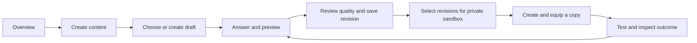

# VTT authoring-to-sandbox design v0.1

**Date:** 27 September 2026. **Phase/status:** DAD-M Apply; design prepared, implementation and acceptance pending. **Retention:** repository artifact. **Boundary:** shared VTT entry/navigation, magic-item authoring and private sandbox use. **Human testing:** deferred by the user until Tuesday, 29 September 2026, Europe/Berlin; exact time and participants remain unrecorded.

## 1. Purpose and source authority

Give an author one understandable journey from the VTT overview to an explicit item design, a saved revision and a private mechanical test. Reuse the VTT's book identity while preserving the engine's current command, permission and replay guarantees.

The [discovery](design-contract-discovery-2026-09-27.md) is the input. This design resolves its design questions within the following source order; implementation gaps remain in the [backlog](test-backlog-2026-09-29.md).

| Source | Selected use in this design |
| --- | --- |
| [Active engine contract](../creation-engine/active-contract.json), spec §§14–15 and 19 | Controls permissions, mechanics, authoring identity, rendering boundaries and accessibility obligations. No UI rule weakens it. |
| [Book design brief](../DESIGNBRIEF_BUCH_UI_2026-08-24.md) | Retain shared paper/ink material, prose/tool typography distinction, chapter orientation and the table boundary. Its historical diagnoses are not treated as current facts. |
| [Overview information architecture](../OVERVIEW_INFORMATION_ARCHITECTURE_2026-08-25.md) | Keep current session/preparation as primary dashboard work; personal content authoring is an additional entry, independent of Discord. |
| [Current runtime integration](../creation-engine/runtime-integration.md) and inspected routes/templates | Establish the available operations and integration boundary. Existing behavior is not automatically accepted design. |
| Older architecture and book session documents | Historical context. They do not select a new page framework, navigation engine or game-state model for this slice. |

Two explicit reconciliations apply. German remains the default product language, but the editor's questions, controls and feedback support German, English and French, as required by G1. A visible disabled action is appropriate only when the viewer may know that action/context exists; unreadable objects and their metadata remain absent under engine policy.

## 2. Current evidence and limits

Source inspection confirms that dashboard, campaigns, characters and character sheet load `theme.css` then `spellbook-theme.css` and carry the book navigation. The editor currently loads only its own dark stylesheet and offers a dashboard backlink. Its current browser fixture is Chromium at 1280×960.

The retained WP8 `authoring-editor.png` was inspected: it shows the dark palette, question/preview columns, stale-answer notice, quality gates and history. It is one historical automated screenshot, not a fresh cross-device audit or human result. Full dashboard-to-editor rendered coverage is a backlog item.

Existing editor browser tests cover mode/locale changes, stale answers, revision saving, an uncertain response, harmless sandbox use and optional damage. Other tests establish backend concurrency, authority and atomicity. These are useful inherited proofs; they do not prove the new visual/navigation target or the human study. No application code or new runtime tests are part of this Apply package.

## 3. Journey and information hierarchy

1. **Entry:** add one contextual dashboard action, “Inhalte erstellen” / “Create content” / “Créer du contenu”, when authoring is configured and available to the signed-in account. It opens the existing `/api/ce/authoring` route. Session/preparation actions retain priority. No new public content library or global fourth navigation chapter is introduced in this slice.
2. **Orientation:** the editor carries the existing overview/campaigns/characters navigation and a local “Inhalte · Gegenstand” title. It must not mark Characters as the current page when the user is authoring an item. The author can return to the overview through a real link, subject to the unsaved/pending-state rules.
3. **Draft selection:** choose an existing private draft or explicitly create one. An empty workspace explains the next action. Merely visiting the editor does not create a draft or choose creative answers. Show a permitted name when available, otherwise a localized untitled label and version; do not present a technical ID as the primary title.
4. **Authoring:** keep mode, language, current draft and save state near the title. Guided presents the next question; Structured exposes applicable questions; Advanced exposes typed owned values and diagnostics. All three edit the same draft through the same commands.
5. **Preview and readiness:** show the consequences of saved answers, unresolved values and quality blockers beside or below the questions. “Save answer” updates the draft; “Save revision” makes a distinct immutable result. Neither action publishes content or installs it in a campaign.
6. **Sandbox:** after a usable revision exists, select the exact revisions for a private test. Creation of the sandbox, each copy, its holder and equip state are explicit. Display copy identity and charges together so two copies cannot be confused.
7. **Outcome and iteration:** show the selected copy/target, costs, confirmed result and manual labels. Returning to edit the draft does not update an existing revision, copy or lock. Testing a changed revision requires a new explicit selection and sandbox.

Normal users see terms such as draft, saved version, item copy, charges and private test. Raw operation names, hashes and compiler identifiers belong in authorized Advanced/diagnostic detail only when useful.

## 4. Visual and component design

Reuse existing shared asset loading and the theme order: shared theme, spellbook theme, then scoped editor styles. Scope feature selectors to the editor so its inputs/buttons/layout do not restyle the rest of the VTT. This design adds no UI framework or animation dependency.

| Element | Selected design |
| --- | --- |
| Page and panels | Existing `--vtt-paper`, `--vtt-paper-panel`, `--vtt-paper-card`; no independent dark editor palette. |
| Text and actions | Existing ink, muted ink, rubrication, field and status tokens. Token reuse still requires measured contrast; it is not automatic accessibility proof. |
| Typography | Existing heading font for title; body serif for authored prose; `--vtt-font-ui` for forms, stats and tool controls. |
| Navigation | Existing book navigation behavior and semantic landmark, with a local editor title. Do not install another navigation or motion engine. |
| Authoring layout | One continuous page below 1200 CSS px. At or above 1200 px, questions and preview may form two columns if controls remain readable. This is a tool layout, not forced two-page book paging. |
| Secondary detail | Preset review and history remain reachable sections/disclosures. Their collapsed state must not conceal a blocker without a visible summary. |
| Small screens and zoom | Main-page horizontal overflow is prohibited at declared test widths. Advanced JSON can wrap or scroll inside its labelled region. Controls and error recovery remain reachable without a fixed panel covering them. |
| Motion | Shared navigation behavior only. Saving, question changes and sandbox outcomes do not turn a book page. Reduced motion removes decorative turns; navigation still works with animation unavailable. |

The page order is title/navigation → draft controls/status → questions and preview → revision action → preset/history → private test. On a narrow screen, reading and keyboard order follow this same sequence. Repeated save actions stay close to the relevant question. The shared status region announces completion but does not replace an inline error at the affected control.

## 5. Interaction states

| State | Required user experience |
| --- | --- |
| Loading | A labelled progress state; no stale object presented as current and no speculative mutation. |
| Empty | Explain that no drafts/sandboxes exist and expose the permitted creation action. |
| Clean draft | Saved version visible; edits remain explicit. |
| Unsaved input | Preserve the entered text; explain why switching draft/mode/locale is unavailable and offer Save or explicit Discard. Guard in-app navigation and browser unload. |
| Saving | One in-flight command; repeated activation cannot create another command. Show that the result is pending. |
| Outcome unknown | State “Result not confirmed”; retain the exact command/key in the open page and offer retry of that command. Do not call it failed or saved until resolved. |
| Version conflict | Preserve the local input for inspection, show that the saved draft changed, and require refresh/reconciliation before another save; no blind overwrite. |
| Invalidated answers | Name permitted affected questions, explain that their old mechanics are inactive and link to the next required answer. History remains available. |
| Quality blocked | Keep the intended readiness visible with actionable permitted blockers. An unresolved value is not zero. |
| Sandbox decision | Show the specified target, copy, cost and answer choices. A declined/timely-expired optional choice retains the hit without spending. |
| Suspended action | Explain the suspension using allowed diagnostics; show manual completion only to the authorized actor and label it manual. |
| Access revoked/unavailable | Stop offering mutation and clear inaccessible visible data. Unknown and inaccessible object references use the same public unavailable presentation. |

Hard tab loss is not a promise of offline command recovery: the current pending envelope is in memory. After tab loss, reload authoritative state and never silently recreate an uncertain command with a new key. Durable offline queues, local storage of secret drafts and automatic replay after tab loss are outside this design. The backlog checks the limit explicitly.

## 6. Existing interfaces and ownership

The browser owns transient controls and rendering; the server owns draft versions, authorization, command outcomes, revisions, locks and mechanical values. Feature visibility never substitutes for server authorization. No new engine command or schema change is required by this design.

| User action | Existing interface |
| --- | --- |
| Open private workspace/draft | `GET /api/ce/authoring/workspace`; `GET /api/ce/authoring/workspaces/<workspace>/drafts/<draft>?locale=…&mode=…` |
| Start or answer a draft | `CreateDraft`, `RecordDraftDecision`, `SkipDraftQuestion`, `RetractDraftDecision` through `POST /api/ce/commands` |
| Review/apply preset | Existing preset GET, then `ApplyDraftPreset` with the reviewed version and `previewDigest` |
| Restore/save revision | `RevertDraft` creates a new draft version; `CommitDraftRevision` validates quality and preserves provenance |
| Resolve an authoring command | Closed `PublicReceipt` plus owner-only workspace/draft command-result reads; no receipt-shape expansion |
| Inspect test content/state | `GET /api/ce/authoring/sandboxes` and `/sandboxes/<scope>` return the authorized catalogue/summary |
| Create test and copies | `CreateSandboxScope`, `InstantiateRevision`, `SetItemEquipped` |
| Use an item/respond | `InvokeActivity` and `ResolveDecision`; the optional damage child is server-only |
| Finish a suspended action | Existing `ResolveActionManually`, authorized scope/action versions and explicit outcome/reason; this UI does not invent resource adjustments |

Transport identity comes from the existing cookie JWT/CSRF flow. Draft saves retain expected draft versions; runtime commands retain scope versions, authority epoch and exact execution-lock identity. Mode and locale changes are reads. The existing Socket.IO dispatch keeps the same semantics if used; this slice does not introduce a second mutation path.

The native profile still explicitly attests hits and recovery events. It supports activation/hit-window durations and does not claim complete attack, resistance or calendar automation. Runtime readiness does not imply automation completeness. Existing imported actors supply statistics; the UI does not manufacture actors or infer their values.

## 7. Acceptance, findings and tradeoffs

The [16 design contracts](authoring-sandbox-contracts-v0.1.md) define observable acceptance. Each maps to engineering or human evidence in the [backlog](test-backlog-2026-09-29.md). Design-specified, implemented and verified are separate states.

| Discovery finding | Design treatment | Residual status |
| --- | --- | --- |
| VD-D01, authority ambiguity | Source order and bounded design catalogue documented; active engine authority retained. | Proposed design selection recorded; no engine authority change. |
| VD-D02, editor theme/navigation divergence | Reuse shared book material and navigation through VD-C01–C03. | Implementation and visual evidence pending. |
| VD-D03, missing coverage | Explicit engineering matrix and deferred human scenarios. | Verification gap remains open; not waived by scheduling. |
| VD-D04, phase confusion | G1 stays Deploy; this UI design is Apply; Tuesday WP8 results feed WP9. | Status documents updated; G1 exit remains open. |
| VD-D05, language/privacy tension | Localize editor in three languages; only permitted unavailable actions are visible. | Tests must verify the selected behavior. |

Medium product risk remains around usability, cross-device behavior and the incomplete T45 task surface. These risks block claims of conformance/acceptance; they are explicit work in the backlog, not a reason to reopen the engine spec. This package authorizes no live deployment. It chooses a narrow dashboard entry instead of a new whole-app content library, and reuses the existing frontend/transport instead of selecting a framework.

## 8. Implementation handoff and rollback

The proposed implementation order is: (1) shared entry/theme/navigation with VD-C01–C03/VD-C15, (2) state/feedback/focus fixes against VD-C04–C14, (3) technical verification and evidence capture, (4) Tuesday human session and subsequent triage. Keep new behavior limited to this journey and preserve existing command payloads. Do not refactor unrelated VTT pages or introduce later-gate mechanics to fill a study gap silently.

Expected implementation surfaces are the dashboard entry, editor template/JS/CSS and focused browser/route tests. The page must use the existing authenticated availability information or a server-derived rendering capability; do not infer permission from a client role name. No domain schema/migration diff or new runtime dependency is proposed.

Feature switches remain default-off. Verification uses isolated fixtures; production campaign migration is outside the handoff. A UI rollback restores the prior entry/template/styles/scripts while retaining drafts, revisions, receipts and sandbox data. Restoring a previous UI must not rewrite content or execution locks.

Before calling a later implementation accepted, attach its exact source/build identity, changed contract IDs, automated results, declared visual/input coverage and unresolved findings. Tuesday may test the existing WP8 editor if this design is not implemented; record that honestly and do not score it as the new design. The human study and unresolved T45 capabilities remain explicit WP9 exit obligations.
